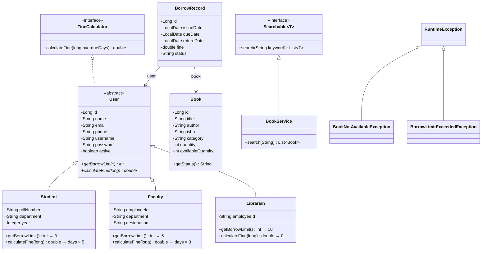

# 📚 Library Management System

> College OOP Mini Project — Java 17 / Spring Boot 3 / H2 / Vanilla JS

---

## 🚀 Quick Start

```bash
# 1. Clone / navigate to the project
cd oop

# 2. Build & run (requires Maven + JDK 17)
mvn spring-boot:run

# 3. Open in browser
http://localhost:8080
```

### Login Credentials

| Role      | Username | Password  |
|-----------|----------|-----------|
| **Admin** | `admin`  | `admin123`|
| Student   | `rahul`  | `pass123` |
| Faculty   | `anjali` | `pass123` |

---

## 📦 Tech Stack

| Layer      | Technology                        |
|------------|-----------------------------------|
| Backend    | Java 17, Spring Boot 3.2, Maven   |
| Database   | H2 (file mode) + Spring Data JPA  |
| Frontend   | HTML, CSS, Vanilla JavaScript      |
| API Style  | REST (JSON)                       |

---

## 🏗️ Folder Structure

```
oop/
├── pom.xml
├── README.md
├── run.bat                          ← 1-Click Windows Launcher (Auto-detects Java & Opens Browser)
├── .gitignore
├── src/main/
│   ├── java/com/library/
│   │   ├── LibraryApplication.java
│   │   ├── DataInitializer.java     ← OOP Seeding (20 books, 6 users, borrow records)
│   │   ├── model/
│   │   │   ├── Searchable.java      ← Interface (Abstraction)
│   │   │   ├── FineCalculator.java  ← Interface (Abstraction)
│   │   │   ├── User.java            ← Abstract class (Inheritance)
│   │   │   ├── Student.java         ← Extends User (Polymorphism: 3 books, ₹5/day)
│   │   │   ├── Faculty.java         ← Extends User (Polymorphism: 5 books, ₹3/day)
│   │   │   ├── Librarian.java       ← Extends User (Polymorphism: 10 books, ₹0)
│   │   │   ├── Book.java            ← Encapsulation (validated fields)
│   │   │   └── BorrowRecord.java    ← Loan lifecycle tracking
│   │   ├── repository/
│   │   │   ├── UserRepository.java
│   │   │   ├── BookRepository.java
│   │   │   └── BorrowRecordRepository.java
│   │   ├── service/
│   │   │   ├── AuthService.java
│   │   │   ├── BookService.java     ← Implements Searchable<Book>
│   │   │   ├── UserService.java
│   │   │   └── BorrowService.java   ← Uses polymorphic calculateFine() & getBorrowLimit()
│   │   ├── controller/
│   │   │   ├── AuthController.java
│   │   │   ├── BookController.java
│   │   │   ├── UserController.java
│   │   │   ├── BorrowController.java
│   │   │   ├── DashboardController.java
│   │   │   └── ReportController.java
│   │   └── exception/
│   │       ├── BookNotAvailableException.java
│   │       ├── BorrowLimitExceededException.java
│   │       └── GlobalExceptionHandler.java   ← Global @RestControllerAdvice
│   └── resources/
│       ├── application.properties
│       └── static/                  ← Pure HTML5, CSS3 & Vanilla JavaScript
│           ├── index.html / login.html
│           ├── dashboard.html / books.html
│           ├── members.html / issue.html / reports.html
│           ├── css/style.css
│           └── js/ (auth, common, dashboard, books, members, issue, reports)
```

---

## 🎓 OOP Concepts Demonstrated

| Concept         | Where                                                        |
|-----------------|--------------------------------------------------------------|
| **Encapsulation** | `User`, `Book` — private fields, getters/setters, validation |
| **Inheritance**    | `User` (abstract) → `Student`, `Faculty`, `Librarian`        |
| **Polymorphism**   | `getBorrowLimit()`: Student=3, Faculty=5; `calculateFine()`: Student ₹5/day, Faculty ₹3/day |
| **Abstraction**    | `Searchable<T>`, `FineCalculator` interfaces                 |
| **Custom Exceptions** | `BookNotAvailableException`, `BorrowLimitExceededException` handled by `GlobalExceptionHandler` |

---

## 📊 UML Class Diagram



---

## ✨ Features

1. **Login** — Token-based session (admin / admin123)
2. **Dashboard** — Stat cards + category bar chart + recent activity
3. **Books** — Add, edit, delete, search by title/author/ISBN/category
4. **Members** — Register (Student / Faculty), edit, deactivate, borrowing history
5. **Issue / Return** — 14-day due date, automatic ₹5/day (Student) or ₹3/day (Faculty) fine
6. **Reports** — Overdue list with fines + export to CSV
7. **Form Validation** — Required fields, success/error toasts

---

## 📝 H2 Console

While the app is running: **http://localhost:8080/h2-console**

- JDBC URL: `jdbc:h2:file:./data/librarydb`
- Username: `sa`
- Password: *(blank)*
